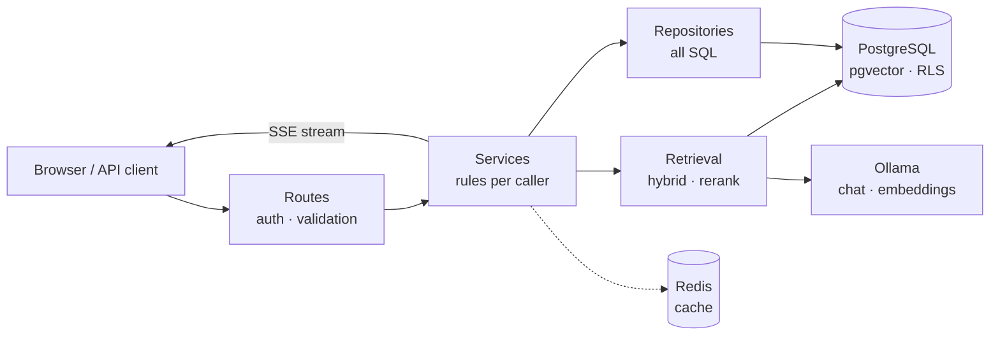

# LocalChat

[](https://www.python.org/downloads/)
[](LICENSE)
[](https://github.com/jwvanderstam/LocalChat/actions/workflows/tests.yml)
[](https://sonarcloud.io/summary/new_code?id=jwvanderstam_LocalChat)
[](https://sonarcloud.io/summary/new_code?id=jwvanderstam_LocalChat)

Chat with your own documents, using a language model that runs on your own hardware.

Upload PDF, Word, PowerPoint, Excel, text, Markdown, email (`.eml`), source code (`.py`,
`.js`, `.ts`) or images. LocalChat chunks and embeds them into PostgreSQL with pgvector and
answers from what it retrieves, with citations. Nothing leaves the machine unless you turn
on web search or a cloud fallback.

**What it is for.** A single-node, self-hosted appliance for a small team, up to 25 users
([ADR-1](docs/ADR.md)). Multi-tenant SaaS and horizontal scaling are out of scope: a second
replica silently breaks caching and rate limiting.

**Status: hardened beta.** Two external audits (September and October 2026) and a
separate security review found real defects, some reachable by any signed-in user. Every
finding is fixed, each with a regression test; the risks knowingly accepted are listed in
[SECURITY.md](SECURITY.md). Read it before you put LocalChat in front of people you do not
already trust.

---

## Quick start

You need Docker with Compose. A GPU helps but is not required.

```bash
git clone https://github.com/jwvanderstam/LocalChat
cd LocalChat
cp .env.example .env
```

Fill in these six values in `.env`; compose refuses to start without them:

| Variable | What it is |
|---|---|
| `PG_PASSWORD` | The database superuser; only used to build the schema at boot |
| `PG_APP_PASSWORD` | The database login every request runs as |
| `SECRET_KEY`, `JWT_SECRET_KEY` | Random strings of 32+ characters |
| `ADMIN_PASSWORD` | The first admin's password, 16+ characters |
| `ENCRYPTION_KEY` | A Fernet key, generated as shown below |

```bash
python -c "from cryptography.fernet import Fernet; print(Fernet.generate_key().decode())"
```

Start it with the prebuilt image (public, signed, `linux/amd64`):

```bash
docker compose pull app
docker compose up -d --no-build
```

Pull a chat model and the embedding model:

```bash
docker compose exec ollama ollama pull qwen2.5:14b        # or llama3.2 on a small GPU or CPU
docker compose exec ollama ollama pull nomic-embed-text
```

The embedding model is required: without it, ingest fails.

Open <http://localhost:5000> and sign in as `admin` with your `ADMIN_PASSWORD`. Select the
chat model under **Models**, upload a document under **Documents**, and ask about it under
**Chat**. Change your password under **Settings → Account**; changing `ADMIN_PASSWORD`
later does not change it.

<details>
<summary>Building the image yourself</summary>

The `app` image is built on [Docker Hardened Images](docs/ADR.md) from `dhi.io`, which
needs a login even for the free tier. Sign in with your Docker ID (not your email) and a
personal access token from app.docker.com:

```bash
docker login dhi.io -u <docker-id>
docker compose build app
docker compose up -d --no-build
```

Without the login, the build fails with `failed to fetch anonymous token ... 401
Unauthorized`. That error is about `dhi.io`, not the LocalChat image.

The image has no shell and runs as uid 65532, so `docker exec ... sh` does not work. Use
`docker compose run --rm --entrypoint python app`. See
[DEPLOYMENT.md](docs/DEPLOYMENT.md#the-application-image).

On ARM with no Docker account, neither image path works for you: run the app on the host
(below), or ask in [Discussions](https://github.com/jwvanderstam/LocalChat/discussions)
for an ARM build.
</details>

<details>
<summary>Running the app outside Docker</summary>

PostgreSQL, Redis and Ollama stay in Docker; only the app moves to the host, with Python
3.12. Useful for a debugger or a fast edit loop, and needs no Docker account.

```bash
pip install -r requirements.txt
docker compose up -d db redis ollama
python app.py
```

This is the only setup where `.env`'s `localhost` URLs apply. In Docker, compose sets
`OLLAMA_BASE_URL`, `PG_HOST` and `REDIS_HOST` itself and overrides `.env`; change them in
`docker-compose.yml` or an override file instead.

If a port is taken (a native Ollama is the usual culprit), move it:
`OLLAMA_BIND_PORT=21434 docker compose up -d ollama`, then set
`OLLAMA_BASE_URL=http://localhost:21434`. `BIND_HOST` and `BIND_PORT` move the others.
</details>

## What it does

- **Retrieval.** Hybrid search: a semantic arm (pgvector) and a lexical arm (PostgreSQL
  full-text), blended and then reranked by a cross-encoder. Tables are kept intact when
  chunking. GraphRAG query expansion exists but is off: measured, it has not changed a
  ranking yet.
- **Answers.** Streamed, with citations, tool calling, optional web search and long-term
  memory from earlier conversations. A cloud model can be configured as fallback.
- **Workspaces and access.** Documents, conversations and memories belong to a workspace,
  enforced by PostgreSQL row-level security. Roles are global (admin, user) and per
  workspace (viewer, editor, owner). Workspace API keys give a bot scoped, revocable access
  to one workspace.
- **Integrity.** Records other data points to are retired, never deleted; purging is a
  separate admin action with preconditions.
- **Sources and plugins.** Connectors for local folders, SharePoint, OneDrive, Google Drive
  and webhooks. Plugins add LLM tools and react to events through a manifest, services and
  hooks; see [plugins/README.md](plugins/README.md).

## How it works



Routes parse, authorise and hand off to a service; all SQL lives in repositories
([ADR-7](docs/ADR.md)). FastAPI and Uvicorn serve it, psycopg3 talks to PostgreSQL 16,
Alembic migrates it. The entry point is `app.py`; every module is listed in the
[module index](.claude/rules/file-map.md).

## Documentation

The full index is **[docs/README.md](docs/README.md)**.

| I want to… | Go to |
|---|---|
| Deploy and run it | [Deployment](docs/DEPLOYMENT.md), [Operations](docs/OPERATIONS.md) |
| Connect a bot or workflow | [Workspace API keys](docs/WORKSPACE_API_KEYS.md), [Discord via n8n](docs/n8n-discord-setup.md) |
| Look up a setting | [Configuration](docs/CONFIGURATION.md), [RAG settings](docs/SETTINGS.md) |
| Fix something | [Troubleshooting](docs/TROUBLESHOOTING.md) |
| Understand a decision | [ADRs](docs/ADR.md) |
| See what is next | [Roadmap](docs/ROADMAP.md), [Changelog](CHANGELOG.md) |

The API is documented live at `/api/docs/`, and these docs are readable in the app under
**Docs**.

## Development

```bash
pip install -r requirements-dev.txt
ruff check .
mypy src --ignore-missing-imports
bandit -r src/ -ll -q -c pyproject.toml
lint-imports
pytest -m "not (slow or ollama or db)"     # the fast suite; no Ollama or database needed
```

All five must pass before a commit. `main` is protected: nine CI checks must pass, among
them integration tests against PostgreSQL, a boot of the hardened image, an attack on the
shipped compose stack and a browser suite, and merging is always a human decision. A
mutation-testing gate runs nightly over the security core and the services.
[CLAUDE.md](CLAUDE.md) and [.claude/rules/](.claude/rules/) hold the standards;
[CONTRIBUTING.md](CONTRIBUTING.md) covers releases and security review.

## Security

Report vulnerabilities as described in [SECURITY.md](SECURITY.md), which also lists the
risks knowingly accepted. Each route's minimum role is in
[PERMISSIONS.md](docs/PERMISSIONS.md).

## License

MIT; see [LICENSE](LICENSE).
